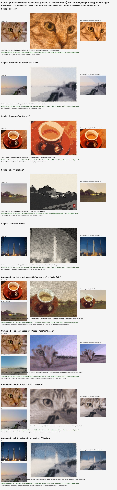

# Reference-photo paintings, photo browsing and the legal rules — QA report (branch `agent/refpaint`)

What the owner asked for:
1. *"Enable Kelo on Netnode to search DuckDuckGo for live reference images rather than using pre-programmed paintings. Kelo should be able to paint directly from a single search result or creatively combine two different search results into one original painting."*
2. *"Browse unlimited photos"*, using every source, from Wikimedia Commons through DuckDuckGo and everything in between.
3. *"Make sure he does something original enough or that the source isn't copyrighted, make sure this aspect is legal."*

> **The live endpoints still need testing on a real connection.** This container's network proxy refuses every photo host: duckduckgo.com, wikimedia.org, openverse, the museums, nasa.gov, loc.gov and the keyed sites. Every adapter was built from each API's documented response shape and tested against stubs that answer in that shape (`qa/refstubs.js`). Nothing in the sources table below could be checked live from here.

`contact-sheet.jpg` shows 9 paintings in 7 media: 5 from one photo, 2 combining a subject with a setting, and 2 split compositions. Each row shows:
- the reference photo(s)
- his painting
- his underpainting
- the credit line exactly as the game writes it
- the measured similarity score
- the list of changes he made

`threshold-examples.jpg` shows examples just under and just over the originality threshold. `refpaint-viewer.png` is the Museum label from the in-game run, and `photobrowse-board.png` is his favourites board.

## Legal approach
Kelo-1 sells paintings to real people. The rules below are enforced in code, not only in the AI prompt, and each one is checked by the harness.

1. **Licence gate.**
   - `refLicenceOk(item)` in `js/refsources.js` sits behind every adapter.
   - A photo can be a painting reference only if its licence is known and allows modified, commercial reuse:
     - public domain, PDM or CC0
     - CC BY or CC BY-SA
     - the Pexels, Unsplash or Pixabay licences
   - NC, ND, "all rights reserved", fair use, non-free, unknown and missing licences are refused.
   - How each source is checked:
     - **Commons:** `extmetadata` `LicenseShortName` / `License` / `LicenseUrl`; `NonFree` and `Restrictions` mean refuse.
     - **Openverse:** queried with `license_type=commercial,modification`.
     - **The Met:** `isPublicDomain === true` only.
     - **Art Institute of Chicago:** `is_public_domain === true` only.
     - **Cleveland Museum of Art:** `share_license_status` must be CC0.
     - **NASA:** only items with no non-NASA photographer or credit, and no ©, "courtesy of" or third-party credit in the description.
     - **Library of Congress:** "no known restrictions" or public domain only.
     - **Flickr:** licence ids 4, 5, 9 and 10 only (BY, BY-SA, CC0, PDM).
     - **Smithsonian:** CC0 media only.
     - **Europeana:** `reusability=open`, then the rights URL must map to CC0, PDM, BY or BY-SA.
     - **Rijksmuseum:** public-domain images only (`permitDownload`).
     - **DuckDuckGo:** the licence is unknown, so it is **looking only**. He looks at its pictures for ideas, then finds a licence-checked photo of the same subject and paints from that. A DuckDuckGo favourite is only an idea and is never painted from.
   - Every reference and every favourite stores the licence, author, title, source and page URL.
2. **Risky content** (`refRiskOk`). These are refused even with a good licence:
   - **People:** an identifiable person as the subject. The word list covers portrait, person, people, selfie, headshot, family members and similar.
   - **Logos and brands:** logos, brands, trademarks and branded products.
   - **Restricted files:** Commons files flagged with personality or trademark restrictions.
   - **Characters:** famous characters and franchises.
   - **Other people's artworks:** photos of murals, sculptures, paintings and so on, unless a museum source marks them public domain or CC0.
   - **Requests:** a visitor's request or an AI plan that names people, brands or characters is refused before any search is made.
3. **Originality**, measured (`refpOriginality`).
   - Every painting makes at least 4 changes, and each one is logged on the record:
     - his own crop, at least 1.06× zoom and off-centre
     - his own limited palette
     - a different light, season or time of day (golden hour, dusk, winter, morning mist or summer noon)
     - his medium's brushwork
   - A combined painting adds a fifth change, and always takes its subject and its setting from **different sources**.
   - The finished painting is then compared with its reference(s):
     - **corr:** the correlation of the 32×24 value maps, also checked against the mirrored photo, keeping the higher score
     - **palette:** the mean distance between the two 6-colour palettes
   - **Too close** means corr ≥ 0.90, or corr ≥ 0.80 with palette < 0.07.
     - A painting that is too close is reworked with a tighter mirrored crop, full-strength light and fewer colours.
     - If it is still too close, it becomes **"Study: …"**, a study, not for sale, kept in his Museum.
   - The score, thresholds, changes and any rework are stored on the record as `originality`.
   - **Calibration** (`threshold-examples.jpg`):
     - Real paintings score corr 0.16–0.77.
     - A lightly blurred copy of the photo scores 0.97–0.998.
     - Just under the line: the field mixed 55% with the photo scores 0.891 (passes); the cat mixed 45% scores 0.737 (passes).
     - Just over the line: the field mixed 65% scores 0.925 (too close); the cat mixed 55% scores 0.814 with palette 0.06 (too close by the second rule).
4. **Credit.** The Museum label and the website listing show credit lines like these:
   - *after "Title" by Author, CC BY-SA 4.0, https://… (Source)*
   - *based on a public-domain image, "Title" by Author (Source, CC0, https://…)*
   - A CC BY-SA reference adds: *This painting is shared under CC BY-SA 4.0*.
   - Everything is escaped, and links are https only.
5. **Website gate** (`refpSellable`, called from `paintingVerdict`, so it applies to every way a painting gets listed):
   - It refuses a study.
   - It refuses any painting made from a photo whose licence data is missing or fails the gate today. That includes earlier saves made from DuckDuckGo with no licence data.
   - Paintings from life (no reference) can be sold as before.
6. **Plain words for players.** `privacy.html#licences` ("Licences and credits for his paintings") is linked from the shop's footer.
7. **Harness checks** (the `refpaint` scenario):
   - fixture metadata for every source, with one bad and one good item each
   - the licence words
   - people, brands, characters and murals
   - DuckDuckGo being looking only
   - one painting forced too close, which must be reworked, become a study, and be refused by the website

Not legal advice; the owner may want a lawyer to review before selling at scale.

## Photo sources
All searches go through one layer (`js/refsources.js`). Each source is a small adapter.
- **Order:** sources take turns in a rotating order, so browsing feels varied. DuckDuckGo stays first where it is usable, but only for looking.
- **Failures:** a source that fails is rested for 3 minutes, a rate limit (429) for 10 minutes, and a 403 for 30 minutes. The search carries on with the others.
- **Keys:** keyed sources appear only after the owner adds a key in Settings, under *Photo sources (optional keys)*. Keys are stored like the AI keys: localStorage on the web, the encrypted file on Windows, the Keychain or Keystore on phones. Each key is sent only to its own host (the harness checks this), and keys are never logged or exported.

| Source | Hosts (exact; all in CSP `connect-src`) | CORS for the web build | Key | Limits (from the docs, **not verified live**) | Licence data used |
|---|---|---|---|---|---|
| DuckDuckGo Instant Answer | api.duckduckgo.com, duckduckgo.com (`/i/` images) | API yes; `/i/` images not known | no | none published | none, so looking only |
| DuckDuckGo image search | duckduckgo.com (`i.js` + vqd token) | **no**, so Windows (main process) and phones (CapacitorHttp) only | no | undocumented; may change or block | none, so looking only |
| Wikimedia Commons | commons.wikimedia.org, upload.wikimedia.org | yes (`origin=*`) | no | API etiquette (serial requests) | `extmetadata` licence, artist, restrictions, non-free |
| Openverse | api.openverse.org (thumbnails too) | yes | no (anonymous) | anonymous requests are throttled; we back off on 429 | `license`, `license_url`; query `license_type=commercial,modification` |
| The Met | collectionapi.metmuseum.org, images.metmuseum.org | API yes; images not known | no | ~80 requests/s | `isPublicDomain` (CC0 Open Access) |
| Art Institute of Chicago | api.artic.edu, www.artic.edu (IIIF) | yes | no | ~60 requests/min | `is_public_domain` (CC0) |
| Cleveland Museum of Art | openaccess-api.clevelandart.org, openaccess-cdn.clevelandart.org | yes (believed) | no | none published | `share_license_status` = CC0 |
| NASA Image Library | images-api.nasa.gov, images-assets.nasa.gov | yes | no | none published | NASA work is PD; third-party credit means refuse |
| Library of Congress | www.loc.gov, tile.loc.gov | **unknown**: if loc.gov sends no CORS, the fetch fails and the source is rested (so it effectively drops out of the web build) | no | burst limits; back-off | `rights_advisory` ("No known restrictions") |
| Pexels | api.pexels.com, images.pexels.com | yes | **key** | 200/hour, 20,000/month (default) | Pexels License |
| Unsplash | api.unsplash.com, images.unsplash.com | yes | **key** | 50/hour (demo apps) | Unsplash License (the `download_location` of a photo he paints from is reported, as Unsplash asks) |
| Pixabay | pixabay.com, cdn.pixabay.com | yes | **key** | 100 requests/minute | Pixabay Content License |
| Flickr | api.flickr.com, live.staticflickr.com | yes | **key** | 3,600/hour | licence ids 4, 5, 9, 10 only |
| Smithsonian Open Access | api.si.edu, ids.si.edu | believed yes | **key** (api.data.gov) | 1,000/hour | media `usage.access` = CC0 |
| Europeana | api.europeana.eu | yes | **key** (wskey) | generous; per key | `reusability=open` + rights URL |
| Rijksmuseum | www.rijksmuseum.nl, lh3.googleusercontent.com | believed yes | **key** | ~10,000/day | `permitDownload` (public domain). Its legacy API is being retired, so it may need a new adapter. `lh3.googleusercontent.com` is an exact but broad Google host. |

Pictures are always fetched (CORS mode, no credentials, no referrer, type and size checked) and decoded as data, so `img-src` needs no new hosts.

## The NetNode "browse photos" pastime (`js/photobrowse.js`)
- **When:** about 30% of his own NetNode visits, or the *Browse photos* button in the Brain tab's "Photos he liked at NetNode" section.
- **Topics:** his curiosities, likes, projects, recent reading, and subjects worth painting.
- **Paging:** one page at a time, only when he gets to it (nothing preloaded), across every source in turn. It continues while he stays interested, with a runaway guard at 200 pages. Now and then a new topic grabs him.
- **The cafe screen:** the computer shows the photos he is looking at, drawn in `interiors.js`.
- **Diary:** a line for what caught his eye, and a web-history entry.
- **Favourites board:**
  - Each favourite keeps a 96×72 JPEG of about 3 KB, plus the title, author, licence, source, page URL and why he liked it.
  - There are at most 24; when the board is full, the oldest unpinned favourite goes, and pins are kept.
  - Favourites have their own save key, `kelo1_brain_v4_photos`.
- **Painting from favourites:**
  - Free-to-use favourites can become paintings, painted from the favourite's own photo.
  - His own choice: about 35% of his reference paintings.
  - With an AI key: the paint decision's `reference.favourite` field, and the prompt lists his free-to-use favourites.

## What changed (files)
| File | Change |
|---|---|
| `js/refsources.js` (new) | The search layer, the 15 adapters, `refLicenceOk`, `refRiskOk`, `refPaintable`, rotating cursor, back-off, keys |
| `js/refpaint.js` (new) | The NetNode trip, DuckDuckGo looking only, finding licensed references, the underpainting (crop, light, palette, subject/setting cut, split seam), `refpOriginality`, credits, `refpSellable`, query safety, the AI prompt field |
| `js/photobrowse.js` (new) | The browsing pastime, cafe screen, favourites board |
| `js/paintrender.js` | Uses the reference underpainting when there is one |
| `js/paintstudio.js` | Reference option, originality check, rework, study, credit in the diary, visitors' requests (with a "no" for people, brands and characters) |
| `js/shopkeeping.js`, `js/shop.js` | Website gate; credit with links on the listing and in `shop-data.json` |
| `js/viewer.js` | Museum label with credit, licence links, thumbnails and the similarity score |
| `js/interiors.js`, `js/netnode.js` | Photos on the cafe screen; NetNode visits sometimes become photo browsing |
| `js/agent.js` | `photoFavourites` state and save part; paint decision `reference` field |
| `js/main.js`, `index.html`, `desktop/main.js`, `js/native.js` | Optional photo-source keys in Settings, stored like the AI keys; the favourites board section |
| `desktop/imagesearch.js`, `desktop/preload.js` | DuckDuckGo image search over IPC (strict safe search; https public hosts only; redirects checked) |
| `index.html`, `scripts/build-web.mjs` | CSP `connect-src`: each exact host above |
| `privacy.html`, `shop.html` | Hosts list; "Licences and credits" section; link from the shop |

## Tests
All runs are on `agent/refpaint` **after merging the latest `origin/main`**, on Chromium without a GPU, with every photo source stubbed (`qa/refstubs.js`, fixtures in `qa/fixtures/refpaint`).

| Run | Result |
|---|---|
| `refpaint` | **46/46 PASS**, page errors: none |
| `photobrowse` | **9/9 PASS**, page errors: none |
| `qa/imagesearch-test.js` (desktop DuckDuckGo search) | **11/11 PASS** |
| reload, ui, chat, vehicle, haul | all finish, page errors: none (reload: disposal record and pit pin survive; haul: 4 loads tipped) |

**`refpaint` covers:**
- The licence gate and the risk check per source:
  - 14 sources, each with fixture metadata containing one bad and one good item: NC, unknown, a third-party NASA credit, unevaluated LoC rights, InC Europeana, a portrait, a logo, a trademark-restricted file
  - DuckDuckGo is looking only
- The licence words and the risky-subject words (people, brands, characters, modern murals, a museum's public-domain art).
- Query safety: no player data in any request, safe search on, each key sent only to its own host.
- Single, subject+setting and split paintings, all from licence-checked sources. Combined paintings take their two photos from different sources.
- At least 3 changes are logged and the similarity score is stored.
- The credit line: "after …" for CC BY / CC BY-SA, CC BY-SA carrying over to the painting, and "based on a public-domain image".
- A painting forced too close is reworked with a mirrored crop, becomes a study, and the website refuses it.
- The website gate: an old painting from life is still sellable; an old reference painting without licence data is refused. A listing keeps its credit.
- The escaped Museum label.
- Reload survival; an old save with every new field stripped; offline painting from life.

**`photobrowse` covers:**
- A browsing session that pages on while he is interested.
- Paging that reaches every source's last page, one page at a time (42 pages across 14 sources).
- The photos on the cafe screen, the diary line, and the favourites board capped at 24 with the pinned favourite kept.
- Small thumbnails (≤ 3.2 KB) and an escaped board.
- Painting from a favourite, using its own picture.
- Favourites surviving a reload in their own save key (about 62 KB for 24 favourites).

## Open items
1. **The live endpoints are untested** (see the top of this report). Before relying on any source, try each one once with a real connection.
   - Check CORS on the image hosts, especially `duckduckgo.com/i/`, `images.metmuseum.org` and `www.loc.gov`.
   - Check the rate limits.
   - Check the Rijksmuseum API, whose legacy version is being retired.
2. **The phone path is untested.** Capacitor's built-in HTTP is used for DuckDuckGo images on phones, but I had no device to try it on.
3. **The risk check is a word filter on the metadata, not image recognition.**
   - A photo whose title and tags don't say "person" or "logo" can still contain one.
   - Commons has no safe-search switch.
   - When the metadata is thin, the filter is deliberately conservative.
4. **Hard case for subject + setting:** a thin subject on a gradient sky (the rocket) brings a patch of its own sky with it.
5. **Licence checks run against what each source says at search time.** The record keeps that snapshot. If a source later changes a file's licence, the website gate still trusts the snapshot.
