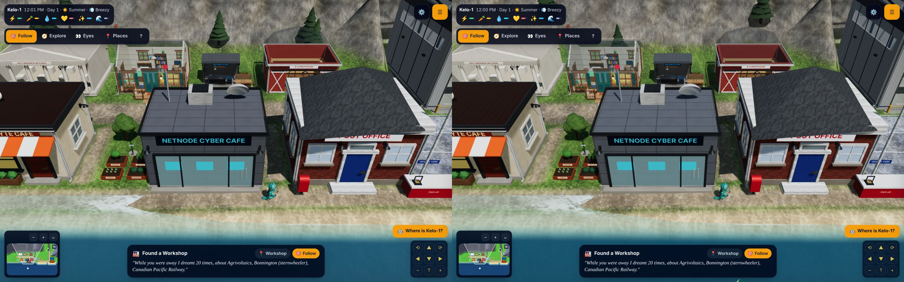
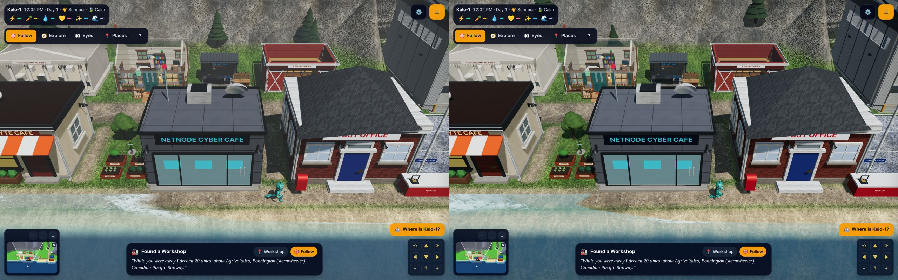
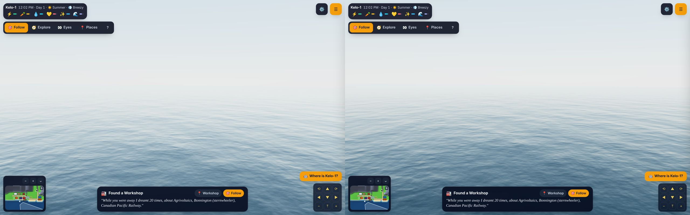
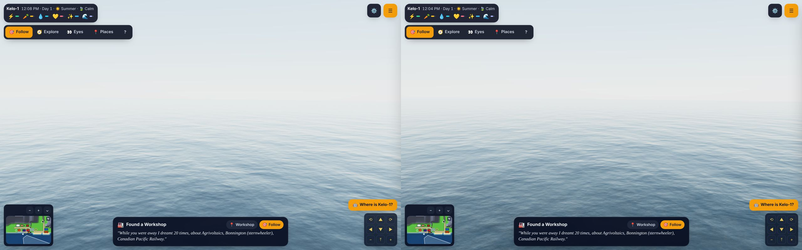
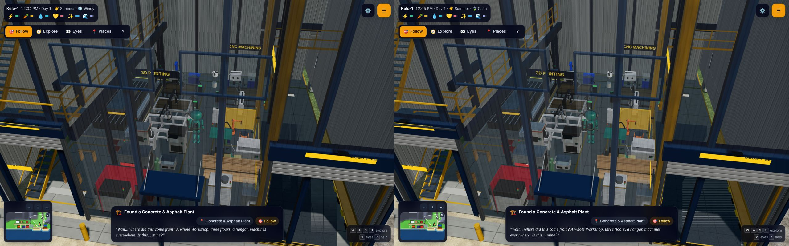
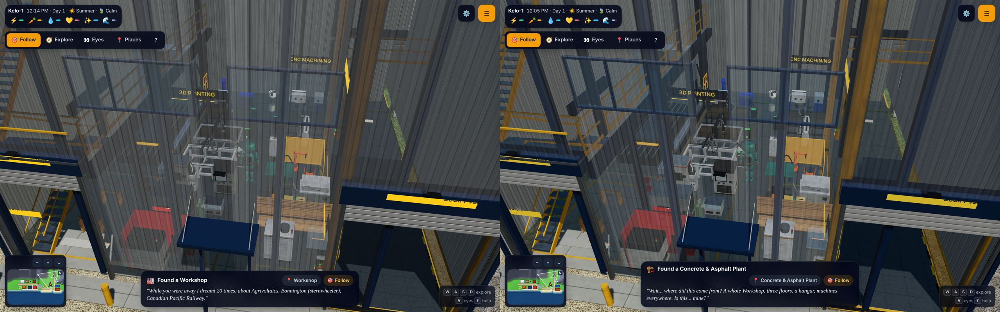
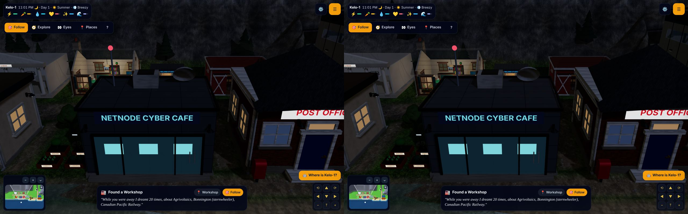
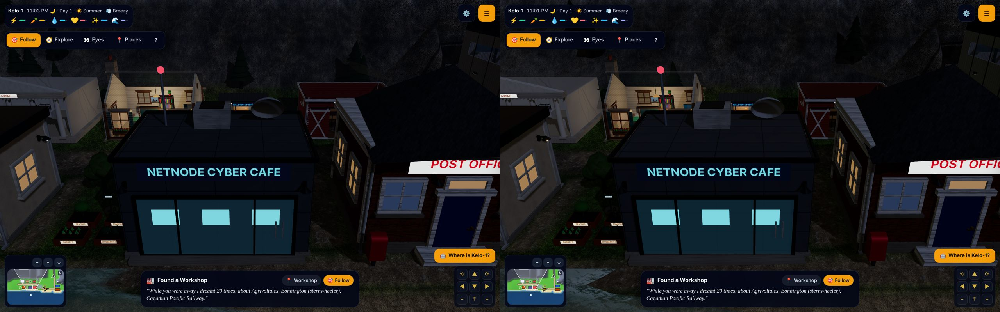
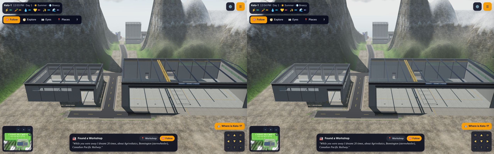
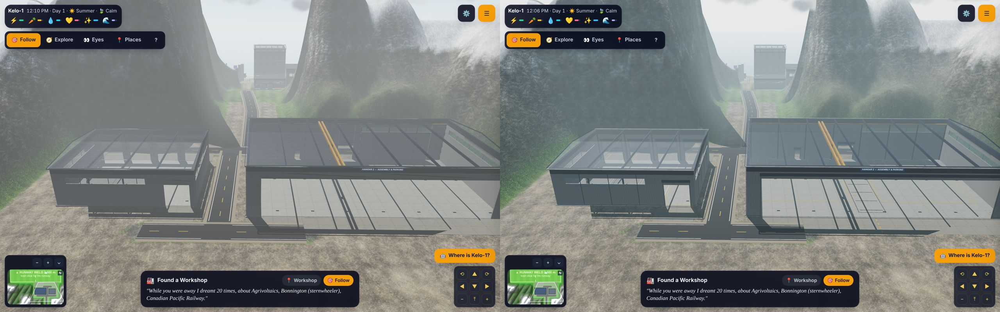

# Three.js r128 → r187: report

Branch `agent/threejs` (code), branch `qa-results-threejs` (this report, screenshots, logs, test scripts).
Latest stable three.js on 2026-11-16: **0.187.0 (r187)**, released 2026-10-30.
Everything below was run in this cloud container: Chromium with software GL (SwiftShader), 1280×800, Balanced graphics unless noted.
Screenshots are at deviceScaleFactor 2; I looked at every pair myself.

## Summary
- **Done:** three.js r128 → **r187**, loaded from one local file (no CDN), every lighting/tone-mapping number in one config (`KELO_LIGHTING`, js/lighting.js), all removed or renamed APIs ported, test kit updated (`qa/` here).
- **Looks:** the same views on r128 and r187 match: light, colours, shadows, water, haze, night (pairs below; mean brightness within 1–8% on Balanced, High brightness within 1–4%). Nothing I looked at got worse; see "Better" and "Worse / open".
- **Animation: identical.** Every joint of Kelo-1 on every one of 9475 frames is the same on r128 and r187 (max difference 0, Classic and Aegis), once three's own random draws are kept out of the game's seeded random (details below).
- **Regressions:** reload, chat, ui, water, gear, haul, vehicle, skills, printshop, skins (54/54): all exit 0, no page errors. An r128 save loads in r187.
- **Speed:** draw calls within ±3%; on a back-to-back pair, frame time and JS time are equal or a little lower on r187 (table below).

## What changed in the code

| Area | r128 | r187 now |
|---|---|---|
| Loading | `three.min.js` from cdnjs, OrbitControls from jsDelivr, 9 add-on copies in `js/vendor/` | One local classic script, `js/vendor/three/three-global.js`, sets `window.THREE` (with the add-ons on it) before any game script runs. Built from the ES-module entry `js/three-global.mjs` by `scripts/vendor-three.mjs` (`npm run vendor:three`) |
| Add-ons | examples/js r128 | examples/jsm r187: OrbitControls, GLTFLoader, HDRLoader (RGBELoader was renamed), Sky, EffectComposer, RenderPass, ShaderPass, UnrealBloomPass, OutputPass |
| Colour | a shader patch in realism.js; `outputEncoding = sRGBEncoding` | `js/lighting.js` (first game script): `outputColorSpace = SRGBColorSpace`, the same colour rules ported to r187's shader chunks, `ColorManagement.enabled = false` on purpose (see below) |
| Lights | `physicallyCorrectLights = true` | r187 has only physically based lights (the flag is gone): the same intensities, every lamp number in `KELO_LIGHTING.lamps`; lights that relied on r128's default decay 1 now say decay 1 |
| Tuning | numbers spread through realism.js, house.js, upgrades.js, weldstudio.js, welding.js, scene.js | **one config: `KELO_LIGHTING` in `js/lighting.js`** (exposure, sky, sun, moon, sky light, HDR gains, haze, shadows, bloom, lamps) |
| Sky | r128 Sky | r187 Sky with r128's gamma lift put back (r187 removed it; without it the sky is far darker and the haze no longer matches), r187's built-in clouds off (the game draws its own) |
| HDR light | RGBE bytes decoded in the game's shader | HDRLoader half-float, sampled directly |
| Bloom (High) | tone-mapped picture + bloom + an sRGB pass | linear picture + bloom + OutputPass (tone mapping moved to the end in r187); threshold 3.2 linear = r128's 0.88 after ACES; haze uses the sky colour before tone mapping on this path |
| Shadows | PCFSoftShadowMap | PCFShadowMap with `shadow.radius` (PCFSoftShadowMap was removed in r186) |
| Clock | `THREE.Clock` | `keloMakeClock()` (Clock is deprecated since r183; same fields, so the test tools still work) |
| Skin previews | render target was tone mapped in r128 | r187 does not tone map render targets, so previews go through OutputPass |
| Item thumbnails (viewer.js) | its own renderer in r128's legacy light mode (×π) | ×π written into the two lights |
| Windows app | XMLHttpRequest file reads | r187's FileLoader uses `fetch()`, which Chromium refuses for `file://`; `three-global.mjs` reads `file:` URLs with XMLHttpRequest again (glTF models and HDR photos) |

### Why three's own colour management stays off
Game code everywhere reads `THREE.Color` numbers back as sRGB: which ground is grass, snow lines, seasonal tints of vertex colours, HSL sorting of materials, grass picked from terrain colours.
With three's colour management on, every hex colour would turn into linear numbers inside the Color and all of that logic would shift.
So a Color keeps the numbers it was given, and the shaders convert material, emissive, vertex, instance colours and pictures from sRGB to linear (as before, now on r187's chunks; each patch is checked at load and logs an error if a chunk ever changes).
Output is `SRGBColorSpace`, lighting is linear and physically based, ACES tone mapping.

### Pictures: who decodes sRGB
`KELO_GPU_DECODES_PICTURES` (lighting.js), default **false**: picture textures stay as they are and the shaders decode them (as r128 did).
Set it to true and pictures are marked `SRGBColorSpace` and the GPU decodes them; the picture is the same.
Measured why the default is false: SwiftShader (also what Chrome uses with no usable GPU) samples sRGB textures much slower.
Town view, one page: GPU-decoded 4067 ms a frame, all pictures shader-decoded 2783 ms (texprobe2.js); with the default now, 4226 vs 3990 ms (noise). Terrain alone: 5406 → 3820 ms (texprobe.js).
On a real GPU the hardware decode is free; the graphics machine may want to flip it.

## Before / after screenshots (same seeded views, noon, summer; night at 23:00)
Left r128, right r187 (final code). Full-size files: `shots/before-*.jpg`, `shots/after-*.jpg`.
The weather line (Breezy/Gale/Calm) and a few hillside firs differ between runs: the test seeds Math.random, and three r187 draws a different number of random UUIDs, so the world's own random sequence shifts (scene.js places those firs with Math.random). That is the test, not the renderer.

| View | Balanced | High (bloom) |
|---|---|---|
| Town |  |  |
| Lake |  |  |
| Workshop (inside) |  |  |
| Night (23:00) |  |  |
| North yard |  |  |

Measured (mean HSV value / saturation of the scene area, 0–255):

| View | Balanced r128 | Balanced r187 | High r128 | High r187 |
|---|---|---|---|---|
| Town | 101.0 / 75.1 | 101.7 / 74.4 | 105.6 / 55.0 | 104.2 / 70.4 |
| Lake | 227.7 / 9.6 | 222.7 / 12.1 | 227.8 / 9.9 | 223.1 / 12.6 |
| North yard | 104.0 / 28.2 | 107.1 / 28.0 | 137.4 / 13.1 | 136.9 / 33.4 |
| Night | 28.1 / 131.2 | 27.7 / 120.8 | 29.2 / 132.9 | 28.2 / 124.5 |
| Workshop | 68.1 / 76.5 | 73.5 / 80.8 | 83.7 / 38.4 | 82.4 / 63.2 |

What I saw: Balanced pairs look the same (the Workshop interior a touch brighter, the lake shows its ripples a little more). On High, r128 washed colours toward grey; r187 keeps them close to Balanced, and the far hills keep the same haze. Skin previews (World tab) match r128 too (checked against the skins report's preview).

## Performance (Balanced, 1280×800, SwiftShader, 5 frames a view)
Back-to-back pair (r128 then r187, same machine state, `logs/perf-pair.log`). JS = time inside the frame function including draw submission; frame = time between frames on software GL (it mostly measures the GPU work, done on the CPU here).

| View | draw calls r128 → r187 | triangles | JS ms/frame | frame ms | shader programs |
|---|---|---|---|---|---|
| Town | 1312 → 1304 | 308k → 299k | 19.1 → 16.9 | 2167 → 2025 | 48 → 41 |
| Lake | 41 → 35 | 176k → 171k | 4.5 → 3.8 | 915 → 899 | 48 → 42 |
| North yard | 1261 → 1291 | 309k → 302k | 15.4 → 14.0 | 2695 → 2605 | 50 → 47 |
| Night | 1491 → 1451 | 307k → 299k | 11.9 → 12.1 | 2299 → 2251 | 50 → 47 |
| Workshop | 1150 → 1161 | 297k → 293k | 12.6 → 12.5 | 3045 → 2941 | 51 → 48 |

Five frames a view on SwiftShader, so ±10% is noise (the first, non-paired runs are in `logs/perf-r128.log` / `logs/perf-r187-first.log`; the r187 numbers there are from before the texture fix below and were 8–27% slower in frame time). Triangle counts differ mostly because the hillside firs are placed with the shifted random (see screenshots). Not measured: a real GPU, a phone.

## Regression tests
`logs/reg/` (first full run), `logs/reg5/` (final run on the merged code, origin/main 5b0c4df), `logs/reg2/` (in between).

| Scenario | Result |
|---|---|
| reload, chat, ui, water, gear, haul, vehicle, skills, printshop | exit 0, no FAIL lines, no page errors (both full runs) |
| skins | 54/54 PASS, no page errors (both full runs; the same 54/54 as when skins merged) |
| load (threesmoke.js) | no page errors, no three.js warnings (only the fonts host, which the tests block) |
| file:// (filecheck.js, Chromium with file access, like Electron's loadFile) | three r187 loads, HDR light and glTF models load (3 of 3 tried: chess set 49 meshes, avocado, olive dish). Without the XMLHttpRequest fallback the HDR photos failed there. **Not run in the real Electron app** (no Electron in this container). |
| Phone apps | not built here (no Android/iOS toolchain); build-web.mjs now copies the local three.js file and checks its version, and the app CSP needs nothing new (no eval, no CDN). |

## Animation
The skins animation check (`qa/skinanim.js`: IK reach, mocap idle and walk, pick up / carry / put down, tool swing, every action clip in kelo-clips.js with enter/loop/exit, driving, through-his-eyes), Classic and Aegis, 9475 frames × 42 joint channels, compared r128 vs r187 with `qa/animdiff.js`:

| Run | max joint diff (rad) | carried item diff | clips played | eyes view: skin parts shown | errors |
|---|---|---|---|---|---|
| plain, separate times | 2.417 / 2.700 | up to 0.17 | 66 vs 63–66 | 0 | 0 |
| **ISO3=1** (three's own random draws kept out of the test's seeded random), r128 and r187 side by side | **0 (Classic), 0 (Aegis)** | **0** | **66 = 66** (not reached on both: sitFeet, machineWait, pickHigh, putHigh) | **0** (Classic has no skin parts; Aegis: 0 of 8 shown) | **0** |

Why the plain runs differ: three.js draws Math.random for every object's UUID, and r187 creates a different number of objects, so the game's seeded random (idle micro-motion, which loop a clip picks) shifts. With those draws separated, both versions produce exactly the same motion. This also explains the "busy vs quiet machine" noise floor in the skins report (2.417 rad): r128's UUID draws while a real-time timer ran. `ISO3=1` is now an option of `qa/skinlib.js`.

## Old save
`qa/savecheck.js`: a save made by the r128 build (all 9 localStorage keys, 52 KB, with a marker written into it) loaded in the r187 build: marker present, his position, skin and mood loaded, no page errors. The harness `reload` scenario passed too. The test save was a fresh world played for about a minute, not a long-lived save.

## Better
- three.js is a local file everywhere: no CDN at start-up (works offline, one less outside host, same file in the site, the Windows app and the phone apps).
- All lighting and tone-mapping numbers live in one config (`KELO_LIGHTING`); the graphics machine can tune there.
- High preset keeps colour: r128 washed it toward grey (High saturation 55 → 70 in town, 38 → 63 in the Workshop).
- Slightly fewer shader programs (41–48 vs 48–51) and equal or lower frame/JS time on the paired run.
- Current three.js: WebGL2 renderer, newer PMREM, GLTFLoader that reads newer files, and add-ons the graphics machine can use (OutputPass, Neutral/AgX tone mapping, newer Sky).
- Found and documented why the animation test had a noise floor (and how to remove it: ISO3).

## Worse / open
- **WebGL 2 is required** (three removed WebGL 1 in r163). Every current desktop and phone browser has it; very old devices without it would no longer start the 3D world. Not tested on such a device.
- **Windows app file reads** rely on the XMLHttpRequest fallback in `js/three-global.mjs`, verified in Chromium with file access but **not in the real Electron app**. Please run `npm start` once.
- **sRGB decoding stays in the shaders** by default (`KELO_GPU_DECODES_PICTURES = false`), as r128 did, because SwiftShader samples sRGB textures ~30% slower. On real GPUs hardware decoding would be free and filter slightly better; flip the switch if software GL doesn't matter.
- **High haze** needs a factor (`fog.postFactor` 0.65) because r187 tone maps at the end of post-processing; brightness matches r128's High, the haze gradient over distance is not exactly the same shape.
- `THREE.ColorManagement` is off on purpose (game logic reads colours as sRGB numbers); code written from three's docs that expects it on (hex colours converted to linear) will look slightly different. lighting.js explains the rule.
- three.js file size: 1.4 MB (277 KB gzipped) vs r128's 600 KB min (about 150 KB gzipped), because it is not minified (no bundler; the dependency-free linker trims comments and indentation only). A build step could minify it.
- Not verified: a real GPU, phones, the Electron app, the phone builds.

## How to run the tests
The scripts are in `qa/` here (copy them into a `qa-tools` checkout's `qa/`):

    NODE_PATH=/opt/node-tools/node_modules KELO_ROOT=<repo> PORT=8920 TAG=after [SHOTS=<dir>] [GFX=high] node threeviews.js
    NODE_PATH=... KELO_ROOT=<repo> node threesmoke.js            # errors and warnings on load
    NODE_PATH=... KELO_ROOT=<r128 repo> MODE=dump SAVE=s.json node savecheck.js; KELO_ROOT=<r187 repo> MODE=load SAVE=s.json node savecheck.js
    NODE_PATH=... KELO_ROOT=<repo> OUT=<dir> node skinanim.js classic@warmup classic aegis; node animdiff.js <dirA> <dirB> classic aegis
    NODE_PATH=... FILEACCESS=1 KELO_ROOT=<repo> node filecheck.js  # file:// like the Windows app
    NODE_PATH=... KELO_ROOT=<repo> node harness.js reload|chat|ui|water|gear|haul|vehicle|skills|printshop|skins
