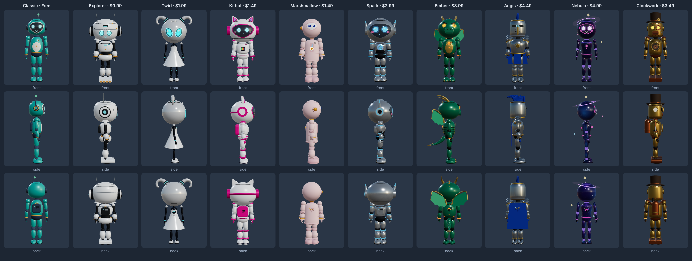
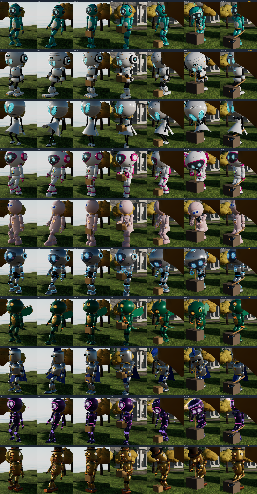
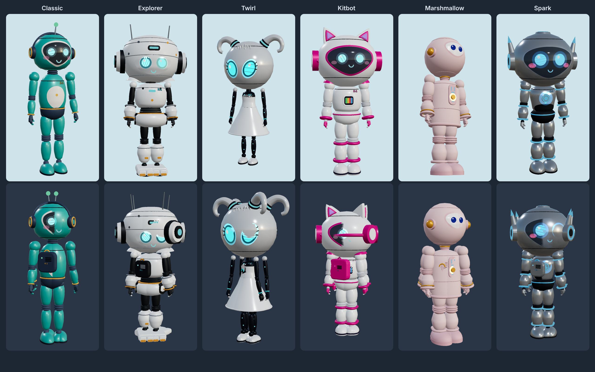
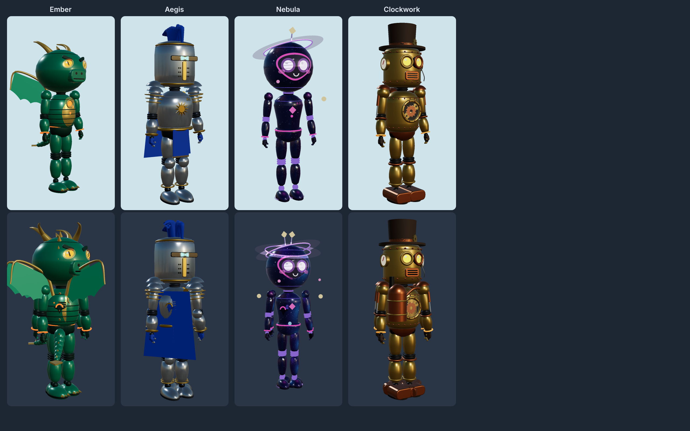
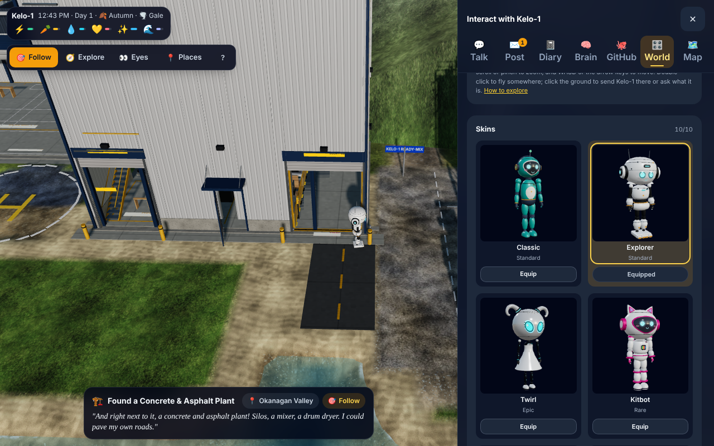

# Kelo-1 skins: QA report

Branch tested: `agent/skins` at `8f73734`, with `origin/main` merged in at `80cb27f` (brain charter, perf, cleanup, the Workshop/town/UI audits, and the pick-up/put-down hand-off and tool swings in `js/kelo-handoff.js`). Every result below was run on that merged code. Software WebGL (SwiftShader) in headless Chromium, Playwright 1.63.



## What changed

- **Ten skins** (`js/skins.js`):
  - **Free:** Classic.
  - **Styled after the owner's reference pictures (details original, nothing copied):** Explorer $0.99, Kitbot $1.49, Marshmallow $1.49, Twirl $1.99, Spark $2.99.
  - **Original legendaries:** Clockwork $3.49, Ember $3.99, Aegis $4.49, Nebula $4.99.
  - Prices are placeholders, formatted with `Intl.NumberFormat`.
- **What a skin can change:**
  - Its palette.
  - Its own body shapes: head and torso turned profiles or rounded boxes, face screen or bare-shell eyes, limb thickness and style, boots.
  - Extra parts hung on bones.
  - Moving parts, updated every frame:
    - Twirl's skirt and Aegis's cape and tabard lift with his legs.
    - Ember's wings beat and his tail sways.
    - Nebula's ring and moons turn.
    - Clockwork's gears spin.
- **The skeleton is never touched.** Joint positions and bone lengths are identical in every skin, so poses, clips, mocap, IK and the hand-off work unchanged; the animation check below shows this.
- **Body builder (`js/kelo-body.js`).** `keloMaterials(skinId)` builds from a palette table (`KELO_MAT_DEFS`), and the builder is driven by `KELO_SHAPE_CLASSIC`. Classic is built from the same numbers as before.
- **Changing skin in place.** `equipKeloSkin(id)` / `equipKeloSkinLook(id)` change skin on the live joints, keeping his position, pose, clip, IK, held tool and carried thing. The old geometries, materials and textures are disposed.
- **Saved state.** `state.skins = { owned, equipped, purchases }` is saved with everything else and repaired on load: an old save without it loads as Classic, unknown ids are dropped, and an equipped skin he doesn't own falls back to Classic.
- **Skins UI (World tab, `js/skinsui.js`):**
  - Cards with live 3D pictures, drawn once into an offscreen target with the game's own renderer and cached.
  - An Equipped chip, Equip for owned skins, and a lock, price and Buy for locked ones.
  - Tap a card for a big turning preview (drag or arrow keys), so you can try a look before buying.
  - His diary notes each new look.
  - Built with the design system's components and tokens and Phosphor icons. It works from the keyboard, and all text is escaped.
- **Payments.** Buying only goes through `skinPayment`. Today that is `mockPayment`: a sheet saying "Dev mode: free unlock, no payment taken", gated by `KELO_DEV_UNLOCK` (on by default, with a toggle in Settings). With the toggle off, Buy says "Payments coming soon" and grants nothing. `.claude/handoff.md` covers plugging in real payments: Stripe on web and Windows, App Store / Google Play in-app purchase on the phone apps, and server-side receipt checks.
- **Through his eyes.** `eyecam.js` hides every skin part in the through-his-eyes view.

## Tests

| Test | Result |
|---|---|
| `skins` scenario (qa/harness.js): buy each of the 9 paid skins through the mock sheet, cancel grants nothing, equip each (state, model and chip), diary entries, reload keeps 10 owned / Explorer equipped / 9 receipts, an old save without `state.skins` loads as Classic, 5 kinds of damaged `state.skins` repaired, dev unlock on by default, toggling it off in Settings (persists after reload), with it off Buy shows no sheet, says "Payments coming soon" and grants nothing (UI and `buySkin()`), keyboard (Enter opens the preview, focus returns), names escaped, no GPU leaks (every geometry, material and texture any skin or preview used is disposed: 2366 / 725 / 33 tracked, 0 left) | **PASS** 54/54, no page errors |
| Animation check, all 10 skins (qa/skinanim.js + skincompare.js) | **PASS** 10/10, see below |
| `reload` | PASS, no page errors |
| `ui` | PASS, no page errors |
| `chat` | PASS, no page errors |
| `vehicle` | No page errors. It prints `vehicle disposed false`; plain `origin/main` prints exactly the same, so it is not from this branch |
| `haul` | PASS (4 loads tipped), no page errors |
| Perf, default town view | PASS: every skin within +3.8% of Classic (limit +15%), see below |

## Animation check (steps 1-3), every skin

### What the check does

Each skin runs the same 9475-frame sequence in a fresh page:
- **Clock and randomness:** a virtual clock at 1/30 s per frame, and seeded randomness for his pose code.
- **Life code held still:** his own life code (decisions, timer emotes, needs) is held still so it can't steer him.
- **Load path, then rebuild:** the skin is loaded as the saved skin, then swapped to Classic and back in place.

The sequence:
1. **IK reach:** both hands to two points in front of his chest (`setKeloReach`).
2. **Idle, then walk:** the mocap idle, then a mocap walk of about 6.3 units.
3. **Pick up, carry, put down:** pick up a box with the new hand-off, carry it a few steps, put it down; then the same with a heavy box.
4. **Tool swing:** an axe, chopping.
5. **Every action clip in `kelo-clips.js`:** each with its enter, loops and exit (sit, type, eat, sitGround, sleep, doze, dig, pick, chop, rake, drill, jackhammer, plant, weld, hammer, saw, sand, drillBench, machine, greet, think, celebrate, inspect, water, paint, fish, fishReel, fishShow, kite, typeStand), then driving (getIn, drive loops, getOut).
6. **Through his eyes:** a check that no skin part shows.

Every frame records all 14 joints × 3 axes and the carried thing's world position. Each skin is then compared with Classic frame by frame.

### Results

| Skin | Joints vs Classic (9475 frames × 42 channels) | Carried item path vs Classic | Joints animating | Hand IK error L / R | Skin parts on their bones (max drift) | Eyes view: skin parts shown | Page errors |
|---|---|---|---|---|---|---|---|
| Classic | reference | reference | 42/42 | 3.18 / 2.46 cm | – | – | 0 |
| Explorer | identical (0 rad) | identical (0 mm) | 42/42 | 3.18 / 2.46 cm | 12 groups, 0 mm | 0/12 | 0 |
| Kitbot | identical | identical | 42/42 | 3.18 / 2.46 cm | 8 groups, 0 mm | 0/8 | 0 |
| Marshmallow | identical | identical | 42/42 | 3.18 / 2.46 cm | 6 groups, 0 mm | 0/6 | 0 |
| Twirl | identical | identical | 42/42 | 2.66 / 3.48 cm (= Classic quiet) | 8 groups, 0 mm | 0/10 | 0 |
| Spark | identical | identical | 42/42 | 2.66 / 3.48 cm | 8 groups, 0 mm | 0/8 | 0 |
| Ember | identical | identical | 42/42 | 2.66 / 3.48 cm | 4 groups, 0 mm | 0/6 | 0 |
| Aegis | identical | identical | 42/42 | 2.66 / 3.48 cm | 8 groups, 0 mm | 0/8 | 0 |
| Nebula | identical | identical | 42/42 | 2.66 / 3.48 cm | 8 groups, 0 mm | 0/9 | 0 |
| Clockwork | identical | identical | 42/42 | 2.66 / 3.48 cm | 8 groups, 0 mm | 0/8 | 0 |

The full table, including clips played, is in [anim-results.md](anim-results.md).

### Notes on the results

- **Two Classic reference runs.** One real-time timer in the page still leaks into the test. Runs made while another browser test shared the CPU (Classic, Explorer, Kitbot, Marshmallow) differ from runs on a quiet machine (the other six). Classic was run in both conditions:
  - Under the same conditions, every skin matches Classic exactly: 0 rad on every joint channel, and 0 mm for the carried box and axe.
  - Classic-busy against Classic-quiet differ by up to 2.4 rad. That is the harness, not the skins.
  - Explorer had already matched Classic exactly across a separate pair of runs before the hand-off merge.
- **Hand IK.** The reach error is the same for every skin as for Classic in the same run. The few centimetres are Classic's own reach limit to these two targets.
- **Clips not reached by the test** (the same for Classic): `sitFeet` plus `paintLook` or `machineWait` (random loop picks), and `pickHigh` / `putHigh` (they need a high shelf target; the test picks up from the ground). 66 of 70 clips play for every skin.

### Frame strips and videos

- **Frame strips:** walk ×2, pick up, carry, put down, tool swing ×2, one per skin in [images/strips/](images/strips/), all together in [images/strips-all.png](images/strips-all.png).
- **Videos:** 75 frames of reach, walk, pick up, carry, put down, the axe swing, sit, weld, dig and sleep for each skin, in [videos/](videos/).
- **Through his eyes:** shots in [eyes/](eyes/), taken while the camera glides in.



## Perf (default town view, draw calls and triangles per frame, shadow pass included)

All skins were measured on the same frozen frames: Classic, then each skin, then Classic again.

| Skin | Draw calls | vs Classic | Triangles | vs Classic | His meshes / triangles |
|---|---|---|---|---|---|
| Classic | 1273 | – | 288,547 | – | 105 / 26,584 |
| Explorer | 1294 | +1.6% | 289,969 | +0.5% | 123 / 30,068 |
| Twirl | 1275 | +0.2% | 294,497 | +2.1% | 110 / 31,444 |
| Kitbot | 1284 | +0.9% | 292,349 | +1.3% | 117 / 30,808 |
| Marshmallow | 1283 | +0.8% | 290,949 | +0.8% | 114 / 30,012 |
| Spark | 1286 | +1.0% | 290,965 | +0.8% | 118 / 31,812 |
| Ember | 1308 | +2.7% | 291,873 | +1.2% | 127 / 29,780 |
| Aegis | 1302 | +2.3% | 296,989 | +2.9% | 128 / 33,016 |
| Nebula | 1274 | +0.1% | 285,465 | −1.1% | 114 / 27,692 |
| Clockwork | 1321 | **+3.8%** | 295,027 | +2.2% | 143 / 33,536 |
| Classic (again) | 1193 | −6.3% | 262,607 | −9.0% | 105 / 26,584 |

Every skin is well inside +15%. The second Classic measurement was lower because the world streamed some things out between the measurements; his own mesh and triangle count was identical. So the world's frame-to-frame swing is larger than any skin's cost.

## Pictures

- **The six skins** (first and third pictures), from about the angle of each reference picture. Light background: that angle; dark: back three-quarter. The reference pictures are not stored here.

  
- **The four legendaries:**

  
- **The Skins UI:**
  - Locked cards: [images/skins-ui-locked.png](images/skins-ui-locked.png)
  - Owned and equipped: [images/skins-ui-owned-equipped.png](images/skins-ui-owned-equipped.png)
  - Preview of a locked skin: [images/skins-ui-preview.png](images/skins-ui-preview.png)
  - Mock purchase sheet: [images/skins-ui-buy-sheet.png](images/skins-ui-buy-sheet.png)
  - Dev unlock toggle in Settings: [images/skins-settings-toggle.png](images/skins-settings-toggle.png)



## How to run

The test scripts are in `qa/`: `harness.js` with the new `skins` scenario, `skinlib.js`, `skinanim.js`, `skincompare.js`, `skinperf.js` and `skinsmoke.js`. Copy them into the `qa-tools` checkout's `qa/` folder, then run:

```
NODE_PATH=/opt/node-tools/node_modules KELO_ROOT=<repo> PORT=8904 node harness.js skins
NODE_PATH=/opt/node-tools/node_modules KELO_ROOT=<repo> PORT=8904 node skinanim.js        # warm-up + all ten (about 30-50 min)
node skincompare.js                                                                          # table + strips
SHEET=all TAG=all10- NODE_PATH=/opt/node-tools/node_modules KELO_ROOT=<repo> PORT=8905 node skinperf.js
```

## Open items

- **Real payments are not built.** Only the mock exists, behind dev mode. The steps for Stripe, App Store and Google Play, with server-side receipt checks, are in `.claude/handoff.md`. Until then, ownership lives only in `state.skins` on the device.
- **Rigid skin parts don't bend.** With the bigger heads, a raised hand can touch the head in wave/celebrate. Twirl's dress, Aegis's cape, Ember's wings and tail and Nebula's ring can pass through a chair back or the bed when he sits or lies down.
- **Eye camera height.** The through-his-eyes camera still sits where Classic's eyes are, which is a little lower than the eyes of the big-head skins. His head is hidden in that view, so nothing shows; it just looks out from slightly lower.
- **Frame strips crop the big heads.** The strip camera is framed for Classic's size, so the biggest heads are cut at the top in some frames.
- **One real-time timer in the page still leaks into the animation test** (busy vs quiet machine, explained above). The test compares each skin with a Classic run made under the same conditions.
- **Four clips aren't reached by the test:** `sitFeet`, `paintLook`/`machineWait`, `pickHigh` and `putHigh`. They are covered only by the shared clip code, the same as Classic.
- **The `vehicle` scenario prints `disposed false` on `origin/main` too.** That is for whoever owns vehicles.
- **The K-1 badge stays on every skin**, by design.
